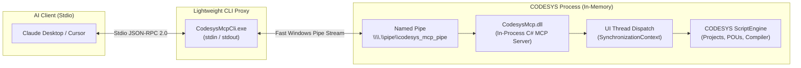

# CODESYS Native C# Stdio MCP Plugin (`codesys-mcp-plugin`)

**English** | [中文](README_zh.md)

---

A high-performance, in-process **Model Context Protocol (MCP)** server for **CODESYS V3.5**, powered by native **C# / .NET** (`CodesysMcp.dll`) and a lightweight **Stdio bridge** (`CodesysMcpCli.exe`).

Enables AI coding assistants (such as **Claude Desktop**, **Cursor**, **Windsurf**, and **Antigravity**) to inspect, edit, compile, and manage CODESYS PLC projects directly with **zero HTTP ports**, **zero network configuration**, and **zero disk file polling**.

---

## 🚀 Key Advantages



1. **Pure Stdio (Zero Network Ports)**:
   - Communicates standard input/output (`stdin`/`stdout`) through `CodesysMcpCli.exe` to a local Windows Named Pipe (`\\.\pipe\codesys_mcp_pipe`).
   - No firewall alerts, no port collisions, and no token/IP exposure.
2. **True In-Process Performance**:
   - Replaces traditional disk polling (`requests/*.json` <-> `results/*.json`) with direct in-memory calls.
   - Response latency drops from hundreds of milliseconds to **single-digit milliseconds**.
3. **CODESYS IDE (GUI) & Thread Safety**:
   - Integrates with the CODESYS IDE UI message loop via `SynchronizationContext.Send()`.
   - Modifying POUs or triggering builds from background threads will never crash or freeze the IDE interface.
4. **No 3S Digital Signature Required**:
   - Bypasses strict third-party `.package` certificate requirements by using CLR native assembly loading inside CODESYS ScriptEngine.

---

## 📁 Repository Layout

```text
codesys-mcp-plugin/
├── bin/Release/
│   ├── CodesysMcp.dll              # In-process C# MCP server loaded by CODESYS CLR
│   └── CodesysMcpCli.exe           # Pure Stdio bridge executable for AI clients
├── CodesysMcp/                     # C# native plugin source code
│   ├── CodesysContext.cs           # CODESYS context & UI thread synchronization
│   ├── CodesysOperations.cs        # Project, POU, and compiler APIs via IExtendedObject.Extensions
│   ├── McpServer.cs                # Named Pipe JSON-RPC 2.0 protocol engine
│   └── ServerBootstrap.cs          # Entry point called by IronPython bootstrap
├── CodesysMcpCli/
│   └── Program.cs                  # High-throughput stdin/stdout pipe forwarder
├── codesys_mcp_session.py          # Session bootstrapper (auto-detects GUI IDE vs --noUI mode)
├── start_codesys_ide_with_mcp.bat  # 1-Click launcher for CODESYS IDE with auto-attached MCP
├── run_codesys_mcp.ps1             # PowerShell runner supporting both GUI and Headless modes
├── launch_mcp.py                   # Python daemon launcher for headless environments
├── build.ps1                       # Automated Roslyn C# build script
├── package_release.ps1             # 1-Click release packaging script
└── test_cli_stdio.py               # End-to-end Stdio MCP regression test suite
```

---

## 🖥️ Installation & IDE Usage

You have **three seamless ways** to attach the MCP server to the CODESYS IDE:

### Method 1: Launch CODESYS IDE with MCP Attached (Recommended)
Double-click [`start_codesys_ide_with_mcp.bat`](start_codesys_ide_with_mcp.bat), or edit your existing CODESYS desktop shortcut Target to:
```cmd
"C:\Program Files\CODESYS 3.5.20.50\CODESYS\Common\CODESYS.exe" --profile="CODESYS V3.5 SP20 Patch 5" --runscript="C:\Users\vboxuser\Desktop\Repos\codesys-mcp-plugin\codesys_mcp_session.py"
```
- **What happens**: CODESYS IDE starts normally with full graphical UI. During startup, `CodesysMcp.dll` is loaded into memory, activates `\\.\pipe\codesys_mcp_pipe`, and finishes foreground script execution immediately.
- The IDE message view will display:
  `[CODESYS MCP] Native Stdio/Pipe MCP Server started on \\.\pipe\codesys_mcp_pipe`
- You can work in the IDE as usual while AI tools read and edit code in real-time.

### Method 2: Load into an Already Running CODESYS IDE
If you already have a CODESYS project open:
1. In the CODESYS top menu, select **`Tools` -> `Scripting` -> `Execute Script File...`**.
2. Select `C:\Users\vboxuser\Desktop\Repos\codesys-mcp-plugin\codesys_mcp_session.py`.
3. The server is immediately active in the background.

### Method 3: Add a Custom Button to CODESYS Toolbar
1. In CODESYS, open **`Tools` -> `Customize...`**.
2. Go to the **`Toolbars`** or **`Menu`** tab.
3. Enable the **`Scripting`** toolbar or add a custom command pointing to `codesys_mcp_session.py`.

---

## 🔌 Client Configuration (Claude Desktop / Cursor / Windsurf)

Add the following to your MCP client configuration (e.g., `claude_desktop_config.json` or `.cursor/mcp.json`). You can optionally specify environment variables for device authentication:

```json
{
  "mcpServers": {
    "codesys": {
      "command": "C:\\path\\to\\codesys-mcp-plugin\\bin\\Release\\CodesysMcpCli.exe",
      "args": [],
      "env": {
        "CODESYS_DEVICE_USER": "admin",
        "CODESYS_DEVICE_PASSWORD": "1111"
      }
    }
  }
}
```

---

## 🔐 Device Authentication & Headless Logon Safety

CODESYS Control runtimes (e.g., SoftPLC `CODESYS Control Win V3 x64`) typically enforce device user management. Unauthenticated login attempts trigger an interactive Win32 modal dialog (`#32770`), causing automated test harnesses or AI agents to hang indefinitely.

This plugin incorporates a **three-tier safety architecture** providing silent, sub-2s automated logins with zero deadlocks:

### 1. Default Credentials & Zero-Interaction Login
* **Default Credentials**: SoftPLC default administrator credentials are username **`admin`** and password **`1111`**.
* **Protocol-Level Handshake**: When `plc_login` is invoked, the plugin injects credentials via `online.set_default_credentials(user, pass)` at the communication layer before dispatching the login request. This suppresses modal logon dialogs at the source.

### 2. Custom Credential Configuration (Three Precedence Levels)

1. **Tier 1: Explicit MCP Tool Arguments (Highest Precedence)**
   AI clients or test runners can pass credentials directly into `plc_login`:
   ```json
   {
     "name": "plc_login",
     "arguments": {
       "application": "Application",
       "username": "custom_user",
       "password": "custom_password"
     }
   }
   ```
2. **Tier 2: Environment Variables in MCP Client Config (Recommended)**
   Set environment variables within your client MCP configuration file:
   * `CODESYS_DEVICE_USER`: Device username
   * `CODESYS_DEVICE_PASSWORD`: Device password
3. **Tier 3: System Environment Variables**
   Set `CODESYS_DEVICE_USER` and `CODESYS_DEVICE_PASSWORD` in the operating system environment.

### 3. Native Win32 Watchdog (`DeviceLogonWatchdog`)
* The plugin runs a background `DeviceLogonWatchdog` scanning the primary UI thread message loop during login execution.
* If an unexpected Win32 modal dialog appears, the watchdog auto-fills credentials; if unhandled, it dispatches `IDCANCEL` within 1 second, **completely eliminating 30-second UI freezes and thread deadlocks**.

---

## ⚙️ Environment Variables & Configuration

| Variable | Default | Description |
| :--- | :--- | :--- |
| `CODESYS_DEVICE_USER` | `admin` | Default username for SoftPLC / target device authentication |
| `CODESYS_DEVICE_PASSWORD` | `1111` | Default password for SoftPLC / target device authentication |
| `CODESYS_MCP_LOG_FILE` | `~/.codesys-mcp-plugin/session_debug.log` | Unified runtime log path (with automatic 10MB rollover) |
| `CODESYS_MCP_PIPE` | `codesys_mcp_pipe` | Windows Named Pipe identifier (`\\.\pipe\codesys_mcp_pipe`) |
| `CODESYS_MCP_PROJECT` | None | Absolute path to a `.project` file to open automatically on startup |

---

## 🛠️ Supported MCP Tools (42 Tools)

### 1. Project Management & Navigation
| Tool Name | Arguments | Description |
| :--- | :--- | :--- |
| `open_project` | `path: string` | Opens an existing `.project` file in CODESYS. |
| `close_project` | None | Closes the currently active project. |
| `save_project` | None | Saves all modifications in the current project. |
| `get_project_info` | None | Returns active project name, file path, dirty status (`isDirty`), and active application. |
| `get_project_tree` | `full?: bool` | Recursively retrieves the project tree (devices, apps, POUs, GVLs, tasks). |
| `create_folder` | `name: string`, `parent?: string` | Creates an organizational folder within the project. |
| `create_interface` | `name: string`, `folder?: string` | Creates a new IEC interface (`ITF`). |
| `create_method` | `pou: string`, `name: string`, `return_type?: string` | Creates a new method (`METHOD`) under a POU or FB. |
| `create_property` | `pou: string`, `name: string`, `type?: string` | Creates a new property (`PROPERTY`) under a POU or FB. |
| `create_boot_application` | `application?: string` | Generates a boot application on the target controller. |

### 2. Code Editing, Search & Snapshot Rollback
| Tool Name | Arguments | Description |
| :--- | :--- | :--- |
| `read_pou` | `name: string` | Reads the declaration (`VAR...END_VAR`) and implementation (`ST`) of a POU. |
| `write_pou` | `name`, `declaration`, `implementation`, `type` | Creates or updates a POU (`Program`, `FunctionBlock`, or `Function`). |
| `delete_pou` | `name: string` | Deletes a POU or object from the project. |
| `search_code` | `query: string`, `is_regex?: bool`, `scope?: string` | Searches plain text or regex across all POUs, GVLs, and DUTs with line numbers and context. |
| `get_diff` | `name?: string`, `section?: string` | Generates standard Unified Diff showing modifications made during the current session. |
| `preview_diff` | `name: string`, `declaration?: string`, `implementation?: string` | Previews changes as a unified diff before applying writes. |
| `rollback_pou` | `name: string` | Safely rolls back a POU to its session baseline snapshot, or deletes it if newly created. |

### 3. Compilation & IDE Message Sensing
| Tool Name | Arguments | Description |
| :--- | :--- | :--- |
| `compile_project` | `clean?: bool`, `rebuild?: bool` | Triggers project compilation and returns structured error/warning messages. |
| `get_compiler_messages` | None | Retrieves compiler errors and warnings without triggering a rebuild. |
| `get_message_categories` | None | Lists all registered message categories in the CODESYS IDE (e.g., Build, Scripting). |
| `get_ide_messages` | `category?: string`, `max_count?: int` | Retrieves IDE messages across specific channels. |

### 4. Online Connection & PLC Control
| Tool Name | Arguments | Description |
| :--- | :--- | :--- |
| `plc_login` | `application?: string`, `username?: string`, `password?: string` | Connects to SoftPLC / device with auto-authentication and watchdog defense. |
| `plc_logout` | `application?: string` | Disconnects online session from the PLC. |
| `plc_control` | `command: string` (`start` / `stop` / `reset_cold` / `reset_warm` / `reset_origin`) | Controls PLC execution state. |
| `get_online_status` | `application?: string` | Queries online connection state, application state, and operating state. |
| `inspect_online` | `application?: string` | Inspects online environment details and topology. |

### 5. Variable I/O, Batch Writes, Structs & Arrays
| Tool Name | Arguments | Description |
| :--- | :--- | :--- |
| `read_variables` | `names: string[]`, `application?: string` | Reads current online values and quality for scalar variables. |
| `write_variable` | `name: string`, `value: string`, `force?: bool` | Writes variable values or forces values online. |
| `batch_write_variables` | `variables: object` | Atomically writes multiple variables in a single batch. |
| `unforce_variables` | `names: string[]` | Unforces active variable overrides. |
| `read_struct` | `name: string`, `application?: string` | Reads all field members and live values of a complex DUT struct. |
| `write_struct` | `name: string`, `values: object` | Sets multiple member fields within a struct. |
| `read_array` | `name: string`, `start_index?: int`, `count?: int` | Reads slice of array elements. |

### 6. Real-time Trace Engine
| Tool Name | Arguments | Description |
| :--- | :--- | :--- |
| `add_trace_variable` | `variable: string`, `task?: string` | Adds a variable to the active trace configuration. |
| `get_trace_info` | `trace_name?: string` | Retrieves trace buffer status, sample count, and timestamps. |
| `analyze_trace` | `trace_name?: string`, `metrics?: string[]` | Analyzes trace data (min/max, settling time, rate of change). |

### 7. Logging & Diagnostics
| Tool Name | Arguments | Description |
| :--- | :--- | :--- |
| `setup_plc_logger` | `application?: string`, `buffer_size?: int` | Configures in-memory cyclic PLC runtime logger. |
| `read_plc_logs` | `application?: string`, `max_entries?: int` | Reads runtime log records from PLC memory. |
| `setup_device_logger` | `device?: string` | Attaches diagnostic logger to target device. |
| `read_device_log` | `device?: string`, `max_entries?: int` | Retrieves hardware and firmware diagnostic logs. |
| `inject_code_log` | `pou: string`, `line: int`, `message: string` | Injects non-intrusive trace logs into source code. |

### 8. IDE UI Indicator & Diagnostics Card
| Tool Name | Arguments | Description |
| :--- | :--- | :--- |
| `get_ui_indicator_status` | None | Returns CODESYS status strip indicator status, heartbeat, total requests, and diagnostics card state. |

---

## 🧪 Building & Verification

### Build from Source
Compile both `CodesysMcp.dll` and `CodesysMcpCli.exe` with the system Roslyn compiler:
```powershell
powershell -ExecutionPolicy Bypass -File build.ps1
```

### Run Automated Unit & Integration Tests
Run the entire test suite (C# Core Unit Tests + Python Protocol Tests):
```powershell
powershell -ExecutionPolicy Bypass -File run_tests.ps1
```
To additionally include live CODESYS E2E tests against an active IDE:
```powershell
powershell -ExecutionPolicy Bypass -File run_tests.ps1 -IncludeE2E
```

### Run Manual Stdio Demonstration
While CODESYS is running (either via IDE or headless), run the automated test:
```powershell
python test_cli_stdio.py
```

### Create Release Package
Generate a distributable zip archive in `dist/`:
```powershell
powershell -ExecutionPolicy Bypass -File package_release.ps1
```

---

## 📄 License

MIT License. See [LICENSE](LICENSE) for details.
