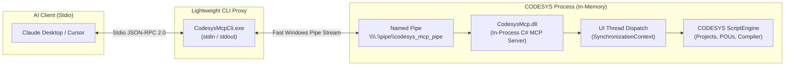

# CODESYS Native C# Stdio MCP Plugin (`codesys-mcp-plugin`)

**English** | [中文](README_zh.md)

---

A high-performance, in-process **Model Context Protocol (MCP)** server for **CODESYS V3.5**, powered by native **C# / .NET** (`CodesysMcp.dll`) and a lightweight **Stdio bridge** (`CodesysMcpCli.exe`).

Enables AI coding assistants (such as **Claude Desktop**, **Cursor**, **Windsurf**, and **Antigravity**) to inspect, edit, compile, and manage CODESYS PLC projects directly with **zero HTTP ports**, **zero network configuration**, and **zero disk file polling**.

---

## 🚀 Key Advantages



1. **Pure Stdio (Zero Network Ports)**:
   - Communicates standard input/output (`stdin`/`stdout`) through `CodesysMcpCli.exe` to a local Windows Named Pipe (`\\.\pipe\codesys_mcp_pipe`).
   - No firewall alerts, no port collisions, and no token/IP exposure.
2. **True In-Process Performance**:
   - Replaces traditional disk polling (`requests/*.json` <-> `results/*.json`) with direct in-memory calls.
   - Response latency drops from hundreds of milliseconds to **single-digit milliseconds**.
3. **CODESYS IDE (GUI) & Thread Safety**:
   - Integrates with the CODESYS IDE UI message loop via `SynchronizationContext.Send()`.
   - Modifying POUs or triggering builds from background threads will never crash or freeze the IDE interface.
4. **No 3S Digital Signature Required**:
   - Bypasses strict third-party `.package` certificate requirements by using CLR native assembly loading inside CODESYS ScriptEngine.

---

## 📁 Repository Layout

```text
codesys-mcp-plugin/
├── bin/Release/
│   ├── CodesysMcp.dll              # In-process C# MCP server loaded by CODESYS CLR
│   └── CodesysMcpCli.exe           # Pure Stdio bridge executable for AI clients
├── CodesysMcp/                     # C# native plugin source code
│   ├── CodesysContext.cs           # CODESYS context & UI thread synchronization
│   ├── CodesysOperations.cs        # Project, POU, and compiler APIs via IExtendedObject.Extensions
│   ├── McpServer.cs                # Named Pipe JSON-RPC 2.0 protocol engine
│   └── ServerBootstrap.cs          # Entry point called by IronPython bootstrap
├── CodesysMcpCli/
│   └── Program.cs                  # High-throughput stdin/stdout pipe forwarder
├── codesys_mcp_session.py          # Session bootstrapper (auto-detects GUI IDE vs --noUI mode)
├── start_codesys_ide_with_mcp.bat  # 1-Click launcher for CODESYS IDE with auto-attached MCP
├── run_codesys_mcp.ps1             # PowerShell runner supporting both GUI and Headless modes
├── launch_mcp.py                   # Python daemon launcher for headless environments
├── build.ps1                       # Automated Roslyn C# build script
├── package_release.ps1             # 1-Click release packaging script
└── test_cli_stdio.py               # End-to-end Stdio MCP regression test suite
```

---

## 🖥️ Installation & IDE Usage

You have **three seamless ways** to attach the MCP server to the CODESYS IDE:

### Method 1: Launch CODESYS IDE with MCP Attached (Recommended)
Double-click [`start_codesys_ide_with_mcp.bat`](start_codesys_ide_with_mcp.bat), or edit your existing CODESYS desktop shortcut Target to:
```cmd
"C:\Program Files\CODESYS 3.5.20.50\CODESYS\Common\CODESYS.exe" --profile="CODESYS V3.5 SP20 Patch 5" --runscript="C:\Users\vboxuser\Desktop\Repos\codesys-mcp-plugin\codesys_mcp_session.py"
```
- **What happens**: CODESYS IDE starts normally with full graphical UI. During startup, `CodesysMcp.dll` is loaded into memory, activates `\\.\pipe\codesys_mcp_pipe`, and finishes foreground script execution immediately.
- The IDE message view will display:
  `[CODESYS MCP] Native Stdio/Pipe MCP Server started on \\.\pipe\codesys_mcp_pipe`
- You can work in the IDE as usual while AI tools read and edit code in real-time.

### Method 2: Load into an Already Running CODESYS IDE
If you already have a CODESYS project open:
1. In the CODESYS top menu, select **`Tools` -> `Scripting` -> `Execute Script File...`**.
2. Select `C:\Users\vboxuser\Desktop\Repos\codesys-mcp-plugin\codesys_mcp_session.py`.
3. The server is immediately active in the background.

### Method 3: Add a Custom Button to CODESYS Toolbar
1. In CODESYS, open **`Tools` -> `Customize...`**.
2. Go to the **`Toolbars`** or **`Menu`** tab.
3. Enable the **`Scripting`** toolbar or add a custom command pointing to `codesys_mcp_session.py`.

---

## 🔌 Client Configuration (Claude Desktop / Cursor / Windsurf)

Add the following to your MCP client configuration (e.g., `claude_desktop_config.json` or `.cursor/mcp.json`):

```json
{
  "mcpServers": {
    "codesys": {
      "command": "C:\\Users\\vboxuser\\Desktop\\Repos\\codesys-mcp-plugin\\bin\\Release\\CodesysMcpCli.exe",
      "args": []
    }
  }
}
```

---

## 🛠️ Supported MCP Tools (`tools/list`)

| Tool Name | Arguments | Description |
| :--- | :--- | :--- |
| `get_project_info` | None | Returns active project name, file path, dirty status (`isDirty`), and active application. |
| `open_project` | `path: string` | Opens an existing `.project` file in CODESYS. |
| `close_project` | None | Closes the currently active project. |
| `save_project` | None | Saves all modifications in the current project. |
| `get_project_tree` | `full?: bool` | Recursively retrieves the project tree (POUs, GVLs, DUTs, devices, tasks). |
| `read_pou` | `name: string` | Reads the declaration (`VAR...END_VAR`) and implementation (`ST`) of a POU. |
| `write_pou` | `name`, `declaration`, `implementation`, `type` | Creates or updates a POU (`Program`, `FunctionBlock`, or `Function`). |
| `delete_pou` | `name: string` | Deletes a POU or object from the project. |
| `compile_project` | `clean?: bool`, `rebuild?: bool` | Triggers project compilation and returns structured error/warning messages. |
| `get_compiler_messages` | None | Retrieves compiler errors and warnings without triggering a rebuild. |

---

## 🧪 Building & Verification

### Build from Source
Compile both `CodesysMcp.dll` and `CodesysMcpCli.exe` with the system Roslyn compiler:
```powershell
powershell -ExecutionPolicy Bypass -File build.ps1
```

### Run Automated Unit & Integration Tests
Run the entire test suite (C# Core Unit Tests + Python Protocol Tests):
```powershell
powershell -ExecutionPolicy Bypass -File run_tests.ps1
```
To additionally include live CODESYS E2E tests against an active IDE:
```powershell
powershell -ExecutionPolicy Bypass -File run_tests.ps1 -IncludeE2E
```

### Run Manual Stdio Demonstration
While CODESYS is running (either via IDE or headless), run the automated test:
```powershell
python test_cli_stdio.py
```

### Create Release Package
Generate a distributable zip archive in `dist/`:
```powershell
powershell -ExecutionPolicy Bypass -File package_release.ps1
```

---

## 📄 License

MIT License. See [LICENSE](LICENSE) for details.
