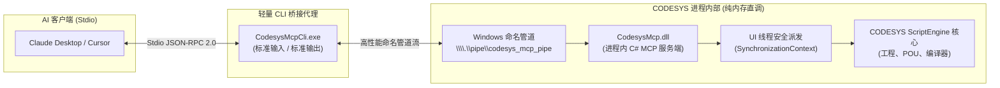

# CODESYS 原生 C# Stdio MCP 插件 (`codesys-mcp-plugin`)

[English](README.md) | **中文**

---

本项目通过 **C# / .NET 原生进程内程序集 (`CodesysMcp.dll`)** 与轻量级 **Stdio 命令行桥接器 (`CodesysMcpCli.exe`)**，为 **CODESYS V3.5** 提供高性能的模型上下文协议（**MCP - Model Context Protocol**）服务。

支持各类 AI 辅助编程客户端（如 **Claude Desktop**、**Cursor**、**Windsurf**、**Antigravity** 等）直接检查、编辑、编译和管理 CODESYS PLC 工程，具备 **零网络端口**、**零防火墙配置** 以及 **零磁盘文件轮询** 的特点。

---

## 🚀 核心架构与技术优势



1. **纯 Stdio 协议（零网络端口）**：
   - 通过 `CodesysMcpCli.exe` 将标准输入输出 (`stdin`/`stdout`) 与本地 Windows 命名管道 (`\\.\pipe\codesys_mcp_pipe`) 直连。
   - 无需开放任何 HTTP/TCP 端口，不触发防火墙警报，杜绝端口冲突与网络暴露风险。
2. **真正的进程内毫秒级响应**：
   - 彻底废弃传统的磁盘文件轮询机制（`requests/*.json` <-> `results/*.json`），所有调用在 CODESYS 进程内部内存完成。
   - 请求延迟从数百毫秒降低至 **个位数毫秒**。
3. **CODESYS IDE (GUI) 线程安全支持**：
   - 通过捕获 `SynchronizationContext.Current`，将后台命名管道收到的指令安全派发至 CODESYS UI 主线程执行。
   - 保证在有界面的 IDE 中修改 POU 或触发编译时，绝不引发界面卡死或并发崩溃。
4. **无需 3S 商业数字签名**：
   - 针对 CODESYS 官方 `.package` 原生插件强制校验商业签名的限制，采用 CLR 运行时原生加载方案，开箱即用。

---

## 📁 目录结构

```text
codesys-mcp-plugin/
├── bin/Release/
│   ├── CodesysMcp.dll              # 注入 CODESYS 进程内部的 C# 核心服务程序集
│   └── CodesysMcpCli.exe           # 纯 Stdio 协议桥接器（供 Claude / Cursor / AI 客户端直接调用）
├── CodesysMcp/                     # C# 进程内插件源码
│   ├── CodesysContext.cs           # CODESYS 上下文与 UI 主线程安全调度 (SynchronizationContext)
│   ├── CodesysOperations.cs        # 工程、POU、编译操作封装（基于 IExtendedObject.Extensions 强类型接口）
│   ├── McpServer.cs                # Windows 命名管道 (\\.\pipe\codesys_mcp_pipe) JSON-RPC 2.0 服务端
│   └── ServerBootstrap.cs          # 供 IronPython 调用的静态启动入口
├── CodesysMcpCli/
│   └── Program.cs                  # 标准输入输出 (stdin/stdout) 到命名管道的无缓冲转发器
├── codesys_mcp_session.py          # CODESYS 启动挂载脚本（自动识别 GUI IDE 模式与无头 --noUI 模式）
├── start_codesys_ide_with_mcp.bat  # 一键启动 CODESYS IDE (带界面) 并自动挂载 MCP 插件
├── run_codesys_mcp.ps1             # PowerShell 启动器（支持 GUI IDE 模式与 -NoUI 后台模式）
├── launch_mcp.py                   # 后台无头模式守护启动脚本（带命名管道就绪探测）
├── build.ps1                       # Roslyn 一键编译脚本
├── package_release.ps1             # 一键 Release 发行包压缩脚本
└── test_cli_stdio.py               # 纯 Stdio 全链路自动化回归测试脚本
```

---

## 🖥️ 如何安装与挂载到 CODESYS IDE 里面？

你可以通过 **3 种方式** 将其挂载运行在 CODESYS IDE 中：

### 方式一：一键启动带插件的 CODESYS IDE（推荐，最省心）
直接双击运行本目录下的 [`start_codesys_ide_with_mcp.bat`](start_codesys_ide_with_mcp.bat)，或修改你桌面上的 CODESYS 快捷方式“目标(Target)”为：
```cmd
"C:\Program Files\CODESYS 3.5.20.50\CODESYS\Common\CODESYS.exe" --profile="CODESYS V3.5 SP20 Patch 5" --runscript="C:\Users\vboxuser\Desktop\Repos\codesys-mcp-plugin\codesys_mcp_session.py"
```
- **运行效果**：CODESYS IDE 正常打开图形界面，启动时在后台加载 `CodesysMcp.dll` 并激活 `\\.\pipe\codesys_mcp_pipe` 管道，随后前台脚本自动退出。
- IDE 底部消息栏会输出：
  `[CODESYS MCP] Native Stdio/Pipe MCP Server started on \\.\pipe\codesys_mcp_pipe`
- 完全不阻塞你在 IDE 中的任何正常开发操作，AI 可随时读写代码。

### 方式二：在已打开的 CODESYS IDE 中手动加载
如果你已经打开了 CODESYS IDE 正在编写工程，无需重启 IDE：
1. 在 CODESYS 顶部菜单栏点击 **`Tools` (工具) -> `Scripting` (脚本) -> `Execute Script File...` (执行脚本文件...)**。
2. 选择 `C:\Users\vboxuser\Desktop\Repos\codesys-mcp-plugin\codesys_mcp_session.py`。
3. 后台命名管道立即激活，AI 客户端即可实时读写你当前在 IDE 中打开的工程。

### 方式三：固定到 CODESYS IDE 顶部工具栏 / 脚本目录（做成 IDE 按钮）
如果你想在 CODESYS IDE 界面里拥有一个专属启动按钮：
1. 打开 CODESYS IDE，点击菜单 **`Tools` (工具) -> `Customize...` (自定义...)**。
2. 切换到 **`Toolbars` (工具栏)** 或 **`Menu` (菜单)** 选项卡，启用 **`Scripting` (脚本)** 工具栏，或者添加 **`Execute Script File`** 命令按钮并指向 `codesys_mcp_session.py`。
3. 之后在 IDE 工具栏点一下图标即可启动 MCP 服务。

---

## 🔌 配置 AI 客户端（纯 Stdio 模式，无需任何 HTTP Server）

无论你使用的是 **Claude Desktop**、**Cursor**、**Windsurf** 还是其他 MCP 客户端，全部统一通过 **Stdio** 调用 `CodesysMcpCli.exe`，无需开启任何端口：

```json
{
  "mcpServers": {
    "codesys": {
      "command": "C:\\Users\\vboxuser\\Desktop\\Repos\\codesys-mcp-plugin\\bin\\Release\\CodesysMcpCli.exe",
      "args": []
    }
  }
}
```

---

## 🛠️ 支持的 MCP 工具列表 (`tools/list`)

| 工具名称 | 参数说明 | 功能描述 |
| :--- | :--- | :--- |
| `get_project_info` | 无 | 获取当前打开工程的名称、路径、修改状态 (`isDirty`)、活动应用名称 |
| `open_project` | `path: string` | 在 CODESYS 中打开指定的 `.project` 工程文件 |
| `close_project` | 无 | 关闭当前打开的工程 |
| `save_project` | 无 | 保存当前打开的工程 |
| `get_project_tree` | `full?: bool` | 递归获取工程对象树（所有设备、应用、POU、GVL、任务及是否有声明/实现代码） |
| `read_pou` | `name: string` | 读取指定 POU 的声明区 (`VAR...END_VAR`) 和实现区 (`ST` 代码) |
| `write_pou` | `name`, `declaration`, `implementation`, `type` | 创建新 POU 或更新已有 POU 的声明区和实现区代码（支持 `Program`、`FunctionBlock`、`Function`） |
| `delete_pou` | `name: string` | 从工程中删除指定的 POU 对象 |
| `compile_project` | `clean?: bool`, `rebuild?: bool` | 编译当前工程并直接返回所有编译报错、警告明细 |
| `get_compiler_messages` | 无 | 不重新触发编译，直接读取当前编译器消息列表 |

---

## 🧪 编译与自测命令

### 源码编译
使用系统内置 Roslyn 编译器直接编译 `CodesysMcp.dll` 和 `CodesysMcpCli.exe`：
```powershell
powershell -ExecutionPolicy Bypass -File build.ps1
```

### 运行自动化单元测试与集成测试
一键运行全量测试集（C# 核心单元测试 + Python 协议集成测试）：
```powershell
powershell -ExecutionPolicy Bypass -File run_tests.ps1
```
如需在 CODESYS IDE 运行时附加全量 E2E 真实环境测试：
```powershell
powershell -ExecutionPolicy Bypass -File run_tests.ps1 -IncludeE2E
```

### 运行手动 Stdio 演示脚本
在 CODESYS 运行状态下（无论是 IDE 模式还是后台无头模式），运行自动化测试：
```powershell
python test_cli_stdio.py
```

### 生成 Release 发行压缩包
一键在 `dist/` 目录下生成可供分发的发布压缩包：
```powershell
powershell -ExecutionPolicy Bypass -File package_release.ps1
```

---

## 📄 开源许可

基于 [MIT License](LICENSE) 开源协议。
