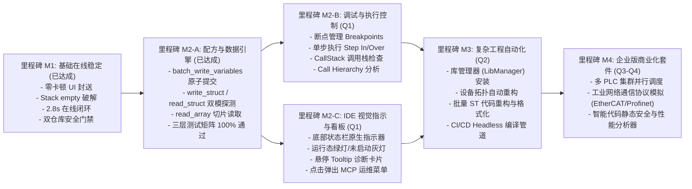

# 第 00 章：产品研发路线图与商业演进计划 (Roadmap 2026)

> [!CAUTION]
> **商业机密与内部规划**
> 本路线图包含 CODESYS MCP 插件的商业化功能规划、协议扩展计划与企业版私有能力定义。严禁推送到公开开源仓库！

---

## 1. 2026 演进目标概览

---

## 2. 核心特性拆解

### 阶段一：高阶配方、在线调试与 IDE 视觉感知 (Q1)

#### 1. 复杂结构体与配方引擎 (M2-A, 已达成 - 2026/10)
- `batch_write_variables`：双阶段单周期原子提交（零撕裂保证）。
- `write_struct`：JSON 递归树自动扁平化注入。
- `read_struct`：DUT 语法树 AST 成员自动探测与 Tuple 双模提取。
- `read_array`：IEC 数组区间切片批量读取与类型剥离。

#### 2. IDE 视觉感知与状态指示器 (M2-C, 新增规划 - 2026/11)
- **需求痛点**：当前 MCP Server 在后台静默运行，工程师在 CODESYS IDE 界面中无法直观感知服务是否已启动、命名管道是否正常、是否有 AI 客户端（如 Cursor / Claude）正在接入或下发指令。
- **产品与架构设计**：
  - **原生状态栏嵌入 (Status Bar Indicator)**：通过 `CodesysContext.RunOnPrimaryThread` 在主窗口底部的 `StatusStrip` 注入专用指示器项（绿灯 `● MCP: Ready` / 黄灯 `● MCP: Busy` / 灰灯 `○ MCP: Offline`）。
  - **悬停 Tooltip 诊断卡片**：鼠标悬停显示状态看板（管道名称、已处理请求数、最近调用工具、最后报错信息）。
  - **快捷上下文菜单 (Context Menu)**：右键/左键点击弹出运维选项（「复制管道路径」、「查看最近 IDE 日志」、「重启 MCP 服务」）。
  - **零侵入与 Headless 兼容**：若在 `--noUI` 模式下启动，自动静默跳过 UI 控件挂载，确保 CI/CD 自动化不产生任何阻碍。

#### 3. 调试与在线执行控制 (M2-B, 下一阶段)
- **断点控制**：实现 `set_breakpoint`、`clear_breakpoint`、`toggle_breakpoint`。
- **调用栈追踪**：实现 `get_call_stack`、`get_current_line`。
- **单步与执行控制**：实现 `step_into`、`step_over`、`step_out`、`resume`。

---

### 阶段二：工程构建与依赖管理 (Q2)
- **自动添加/解析设备拓扑**：动态插入 SoftMotion 虚拟轴、CanOpen 从站、EtherCAT 伺服驱动器。
- **库文件自动管理**：检测缺失库依赖并静默从中央仓库下载安装。

---

### 阶段三：云原生与协同平台 (Q3-Q4)
- **容器化 SoftPLC 矩阵**：在 Docker / Hyper-V 容器集群内自动化调度测试任务。
- **AI 智能代码审查器**：自动分析 IEC 61131-3 代码圈复杂度、非确定性循环风险及指针越界隐患。
