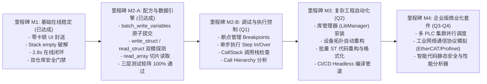

# 第 00 章：产品研发路线图与商业演进计划 (Roadmap 2026)

> [!CAUTION]
> **商业机密与内部规划**
> 本路线图包含 CODESYS MCP 插件的商业化功能规划、协议扩展计划与企业版私有能力定义。严禁推送到公开开源仓库！

---

## 1. 2026 演进目标概览

---

## 2. 核心特性拆解

### 阶段一：高阶在线配方与调试能力 (Q1)
- **复杂结构体与配方引擎 (M2-A, 已达成 - 2026/10)**：
  - `batch_write_variables`：双阶段单周期原子提交（零撕裂保证）。
  - `write_struct`：JSON 递归树自动扁平化注入。
  - `read_struct`：DUT 语法树 AST 成员自动探测与 Tuple 双模提取。
  - `read_array`：IEC 数组区间切片批量读取与类型剥离。
- **断点控制 (M2-B, 下一阶段)**：实现 `set_breakpoint`、`clear_breakpoint`、`toggle_breakpoint`。
- **调用栈追踪 (M2-B)**：实现 `get_call_stack`、`get_current_line`。

### 阶段二：工程构建与依赖管理 (Q2)
- **自动添加/解析设备拓扑**：动态插入 SoftMotion 虚拟轴、CanOpen 从站、EtherCAT 伺服驱动器。
- **库文件自动管理**：检测缺失库依赖并静默从中央仓库下载安装。

### 阶段三：云原生与协同平台 (Q3-Q4)
- **容器化 SoftPLC 矩阵**：在 Docker / Hyper-V 容器集群内自动化调度测试任务。
- **AI 智能代码审查器**：自动分析 IEC 61131-3 代码圈复杂度、非确定性循环风险及指针越界隐患。
