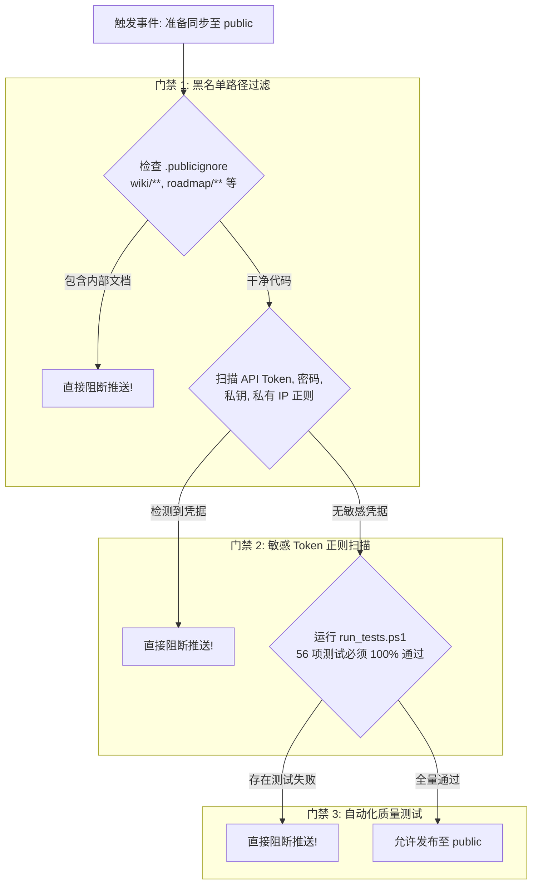

# 第 05 章：双仓库治理与安全防泄漏门禁

## 1. 业务背景与治理挑战
- **商业与开源并存**：核心 MCP 工具与基础能力开源在公开仓库（`Zhgong/codesys-mcp-plugin`），而最新的前沿特性、商业版本规划、内部测试工程与产品路线图需要保存在私有仓库（`Zhgong/codesys-mcp-plugin-private`）。
- **核心风险**：在单一工作区内，开发者极容易因为 `git push` 的一次手抖，将内部 `wiki/` 路线图、未经脱敏的内部 IP 或商业配置推送到公开仓库，造成无法挽回的泄密事故。

---

## 2. 防误触双 Remote 架构

### 2.1 本地 Remote 配置原则
通过将私有仓库设置为默认的 `origin`，从根源上降低操作风险：
```bash
# origin 永远是私有仓库，日常操作 100% 封闭
origin -> https://github.com/Zhgong/codesys-mcp-plugin-private.git

# public 显式命名为公开仓库，默认不参与日常提交
public -> https://github.com/Zhgong/codesys-mcp-plugin.git
```
开发者日常的 `git commit` 和 `git push` 全部只与私有仓库打交道。

---

## 3. 三道安全门禁系统（Security Gatekeeper）



### 3.1 规则清单文件
- [`.public_gate_rules.json`](file:///C:/Users/vboxuser/Desktop/Repos/codesys-plugin/.public_gate_rules.json)：定义严格的路径通配符与 Token 正则表达式。
- [`.publicignore`](file:///C:/Users/vboxuser/Desktop/Repos/codesys-plugin/.publicignore)：定义在开源版本中需要排除的目录（`wiki/`, `roadmap/`, `docs/internal/`, `api_keys.json`）。

### 3.2 物理拦截：Git `pre-push` Hook
在 [`.githooks/pre-push`](file:///C:/Users/vboxuser/Desktop/Repos/codesys-plugin/.githooks/pre-push) 中植入前置拦截器。当检测到推送目标包含 `public` 时，强制在底层触发门禁检测：
- **实测结果**：即使用户在命令行误敲 `git push public development`，底层的 Git Hook 也会直接拦截退出，返回 `[SECURITY GATE REJECTION]`，推不动代码。

---

## 4. 自动化过滤发布工具：[`sync_to_public.ps1`](file:///C:/Users/vboxuser/Desktop/Repos/codesys-plugin/sync_to_public.ps1)

为了解决“**私有仓库需要保留 `wiki/`，但公开仓库严禁包含 `wiki/`**”的矛盾，我们设计了 `-FilterIgnored` 自动化发布模式：

```powershell
# 1. 试运行预览（Dry Run）
powershell .\sync_to_public.ps1 -DryRun -FilterIgnored

# 2. 正式发布
powershell .\sync_to_public.ps1 -FilterIgnored
```

### 执行逻辑：
1. 从当前私有分支自动拉取临时的 `public-release` 分支。
2. 依据 `.publicignore` 清单安全剥离内部文件（`wiki/` 等）。
3. 自动生成纯净发行 Commit，并运行 3 道安全门禁。
4. 提示开发者交互式确认 `[y/N]`，推送至公开仓库的对应分支。
5. 推送完成后自动切回开发者的原始分支，**私有分支中的内部文件丝毫未损**！

